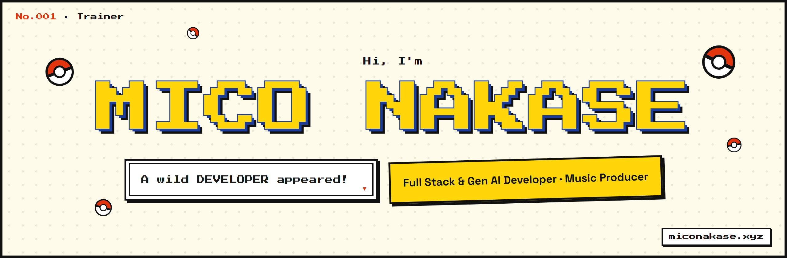

  

  <strong>Mico L. Nakase</strong> — <em>Full Stack & Generative AI Developer · Music Producer</em> 
  Junior AI Engineer at <strong>Prosperna Philippines</strong> · Producer & External VP at <strong>Truchorus Performance Company</strong>

  
  

  
  &nbsp;&nbsp;
  

---

### About Me

I'm a Full Stack & Generative AI Developer and music producer who enjoys building things that look good and work well. I like writing clean code just as much as I like producing beats — always learning, always creating.

- 💼 Junior AI Engineer at **Prosperna Philippines**
- 🎤 Producer & External Vice President at **Truchorus Performance Company**
- 🎓 BS Information Technology at **Saint Francis Institute of Computer Studies**
- 🎵 6 original tracks produced · coding since 2022
- ⚡ Rubik's Cube under 40 seconds · ☕ Fuel: dark roast coffee
- 🏐 Off the desk: volleyball, basketball, chess and playing instruments

---

### Skills

  <strong>AI</strong>

  
  
  

 

  <strong>FRONT END</strong>

  
  
  
  
  
  
  

 

  <strong>BACK END</strong>

  
  
  
  
  
  
  
  

 

  <strong>DATABASE</strong>

  
  
  

 

  <strong>TOOLS</strong>

  
  
  
  
  
  
  
  
  
  

 

---

### Programming Works

<table width="100%">
  <colgroup>
    <col width="25%">
    <col width="45%">
    <col width="30%">
  </colgroup>
  <tr>
    <th>Project</th>
    <th>Description</th>
    <th>Stack</th>
  </tr>
  <tr>
    <td><a href="https://github.com/miconakase/my-portfolio">My Portfolio</a> 2026 · Solo · <a href="https://www.miconakase.xyz">Live</a></td>
    <td>Pokémon-inspired, neo-brutalist personal portfolio — Pokédex loading screen, a flippable trading card, a built-in music player and a MongoDB-backed admin app</td>
    <td>   </td>
  </tr>
  <tr>
    <td><a href="https://github.com/miconakase/ReservationSystem">Kevin's Express Studio</a> 2025 · Capstone</td>
    <td>Full-stack booking platform for music studio scheduling — real-time availability, client and session history, and an admin dashboard</td>
    <td>  </td>
  </tr>
  <tr>
    <td><a href="https://github.com/miconakase/mokusei-ai">Mokusei AI</a> Ongoing</td>
    <td>Multi-agent AI framework with distinct personalities and expertise, powered by Jupiter's Moon</td>
    <td> </td>
  </tr>
  <tr>
    <td><a href="https://github.com/miconakase/truchorus-frontend">Truchorus Website</a> Ongoing</td>
    <td>Website for Truchorus Performance Company</td>
    <td></td>
  </tr>
  <tr>
    <td><a href="https://github.com/miconakase/daily-spot-cafe">Daily Spot Cafe</a> Commission</td>
    <td>E-commerce platform with ordering system and menu management for Daily Spot Cafe</td>
    <td> </td>
  </tr>
</table>

### Music Works

Original tracks produced with **Truchorus Performance Company** — listen on [miconakase.xyz](https://www.miconakase.xyz/#works).

<table width="100%">
  <colgroup>
    <col width="30%">
    <col width="10%">
    <col width="20%">
    <col width="40%">
  </colgroup>
  <tr>
    <th>Track</th>
    <th>Year</th>
    <th>Genre</th>
    <th>Recognition</th>
  </tr>
  <tr><td>Mui Mui</td><td>2025</td><td>Rap · Hip-hop · Rock</td><td>Inspired by the short story "Ang Ama"</td></tr>
  <tr><td>Ligtas</td><td>2025</td><td>OPM Pop</td><td>🥈 1st Runner Up · CDRRMO Musikaligtasan 2025</td></tr>
  <tr><td>Mahiwagang Laguna</td><td>2024</td><td>Orchestral Pop</td><td>Anilag Festival 2024 entry</td></tr>
  <tr><td>Samyo ng San Pedro</td><td>2024</td><td>Pop Ballad</td><td>Sampaguita Festival 2024 entry</td></tr>
  <tr><td>Sa Laguna</td><td>2023</td><td>Pop</td><td>Anilag Festival 2023 entry</td></tr>
  <tr><td>Ariba! Bagong San Pedro</td><td>2022</td><td>Pop Rock</td><td>🏅 Finalist · Tunog San Pedro 2022</td></tr>
</table>

### AI Agent Skills

Custom AI agent skills for autonomous codebase workflows, collected in [agent-skills](https://github.com/miconakase/agent-skills):

<table width="100%">
  <colgroup>
    <col width="20%">
    <col width="15%">
    <col width="65%">
  </colgroup>
  <tr>
    <th>Skill</th>
    <th>Type</th>
    <th>Description</th>
  </tr>
  <tr>
    <td><a href="https://github.com/miconakase/agent-skills/tree/master/tailwind-v4-grader">tailwind-v4-grader</a></td>
    <td>Auditor</td>
    <td>Audits Tailwind v4 projects against best practices, produces a scored report card with prioritized improvement plan</td>
  </tr>
</table>

---

### Journey

**Experience**

- **Junior AI Engineer** — Prosperna Philippines · *Sep 2026 – Present*
- **Full Stack & Generative AI Developer Intern** — Prosperna Philippines · *Feb 2026 – Jul 2026*

**Leadership**

- **External Vice President** — Truchorus Performance Company · *2024 – Present*
- **SBO President** — Saint Francis Institute of Computer Studies · *2024 – 2026*
- **SBO Vice President** — Saint Francis Institute of Computer Studies · *2023 – 2024*
- **President** — Cascop Compound Youth Organization · *2022 – 2023*
- **SSC Business Manager** — San Francisco De Sales School · *2021*

**Education**

- **BS in Information Technology** — Saint Francis Institute of Computer Studies · *2022 – Present*
- **STEM (Senior High School)** — San Francisco De Sales School · *2020 – 2022*

---

### Find Me Online

- **Portfolio:** [miconakase.xyz](https://www.miconakase.xyz)
- **GitHub:** [github.com/miconakase](https://github.com/miconakase)
- **LinkedIn:** [linkedin.com/in/mico-nakase](https://www.linkedin.com/in/mico-nakase-0835b1391)
- **TikTok:** [tiktok.com/@micodevph](https://www.tiktok.com/@micodevph)
- **Instagram:** [@itsmicssss_](https://www.instagram.com/itsmicssss_/)
- **Facebook:** [facebook.com/mics12345](https://www.facebook.com/mics12345)
- **Email:** [miconakaseyt@gmail.com](mailto:miconakaseyt@gmail.com)

📍 San Pedro, Laguna · 🟢 Open for commissions

---

  © 2026 Mico Nakase

