

  <a href="https://www.miconakase.xyz"><picture><source media="(prefers-color-scheme: dark)" srcset="art/out/banner-dark.png">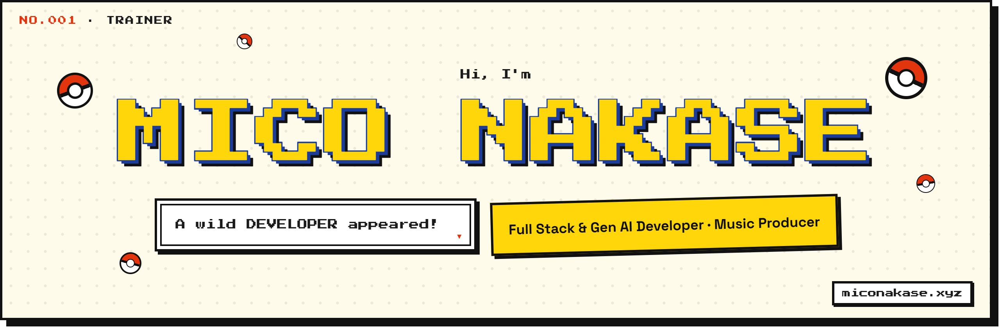</picture></a>

  <a href="https://www.miconakase.xyz"><picture><source media="(prefers-color-scheme: dark)" srcset="art/out/btn-portfolio-dark.png"></picture></a>&nbsp;&nbsp;<a href="https://www.miconakase.xyz/Nakase_Mico_CV.pdf"><picture><source media="(prefers-color-scheme: dark)" srcset="art/out/btn-cv-dark.png">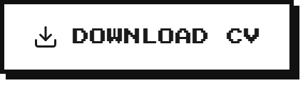</picture></a>&nbsp;&nbsp;<a href="https://github.com/miconakase"><picture><source media="(prefers-color-scheme: dark)" srcset="art/out/btn-github-dark.png"></picture></a>&nbsp;&nbsp;<a href="https://www.linkedin.com/in/mico-nakase-0835b1391/"><picture><source media="(prefers-color-scheme: dark)" srcset="art/out/btn-linkedin-dark.png"></picture></a>

 

<picture><source media="(prefers-color-scheme: dark)" srcset="art/out/h-about-dark.png">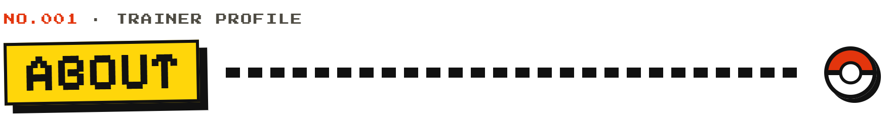</picture>

  <picture><source media="(prefers-color-scheme: dark)" srcset="art/out/about-dark.png">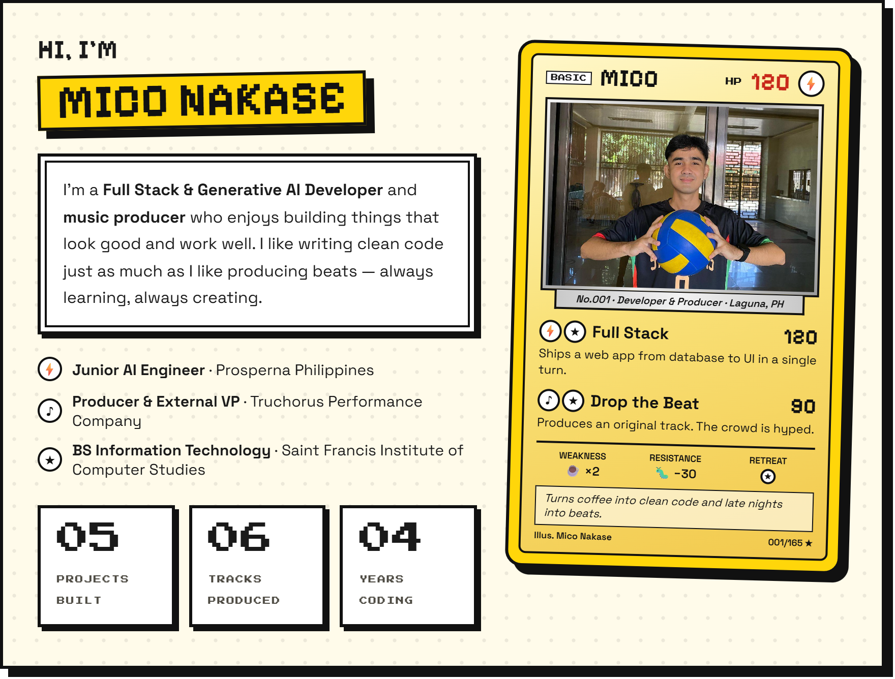</picture>

- ⚡ Rubik’s Cube under 40 seconds
- 🎵 Favorite genre: Punk Rock / Alternative Rock
- ☕ Fuel: dark roast coffee
- 🏐 Off the desk: volleyball, basketball, chess and playing instruments

 

<picture><source media="(prefers-color-scheme: dark)" srcset="art/out/h-skills-dark.png"></picture>

  <picture><source media="(prefers-color-scheme: dark)" srcset="art/out/skills-dark.png">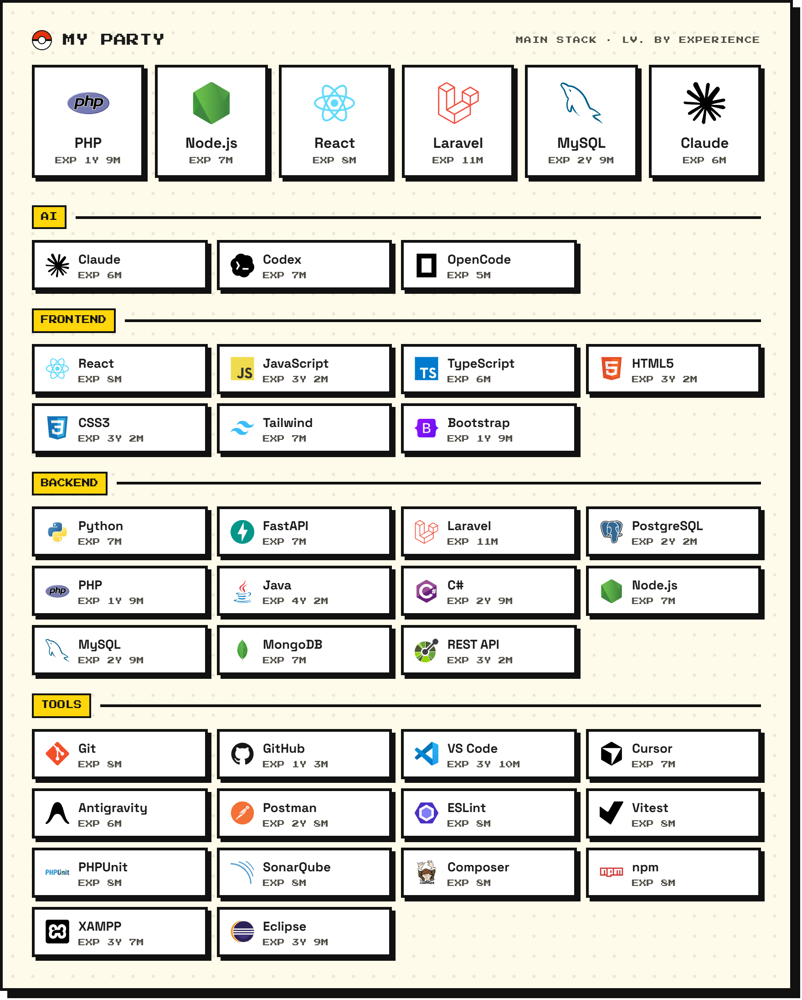</picture>

  
  

<picture><source media="(prefers-color-scheme: dark)" srcset="art/out/h-works-dark.png"></picture>

  <a href="https://github.com/miconakase/ReservationSystem"><picture><source media="(prefers-color-scheme: dark)" srcset="art/out/work-ReservationSystem-dark.png">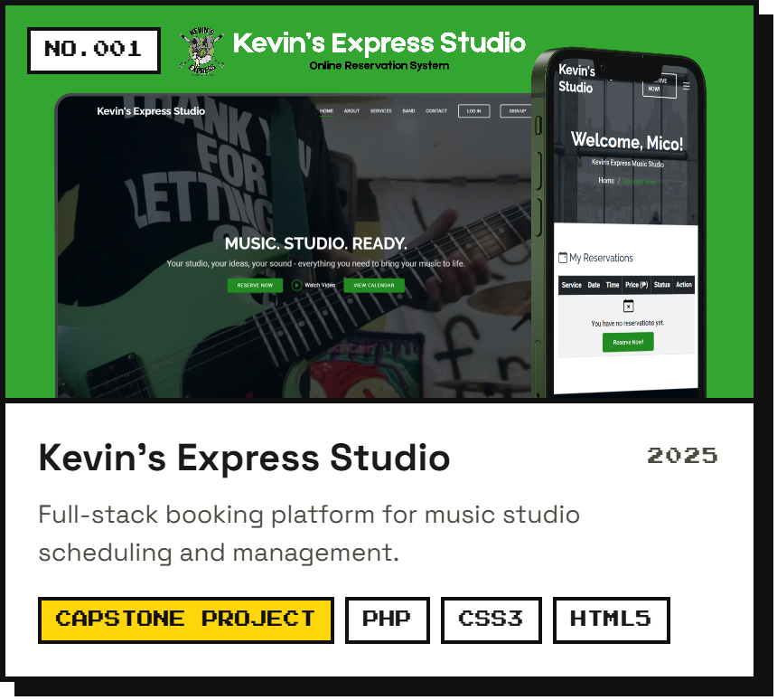</picture></a>
  <a href="https://github.com/miconakase/my-portfolio"><picture><source media="(prefers-color-scheme: dark)" srcset="art/out/work-my-portfolio-dark.png">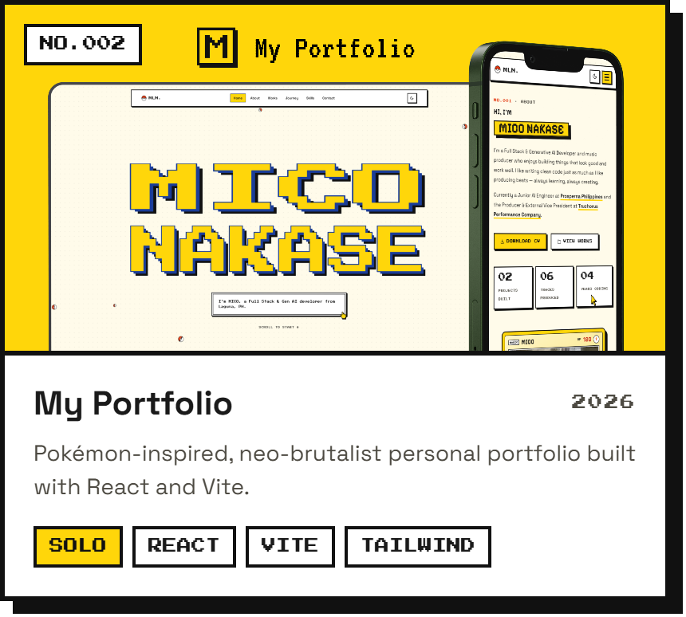</picture></a>

  <a href="https://github.com/miconakase/mokusei-ai"><picture><source media="(prefers-color-scheme: dark)" srcset="art/out/work-mokusei-ai-dark.png">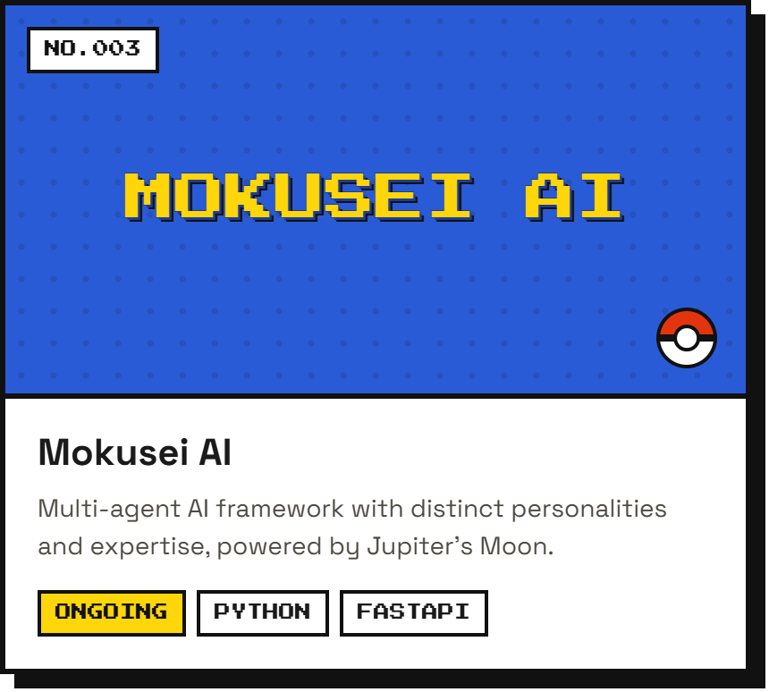</picture></a>
  <a href="https://github.com/miconakase/truchorus-frontend"><picture><source media="(prefers-color-scheme: dark)" srcset="art/out/work-truchorus-frontend-dark.png">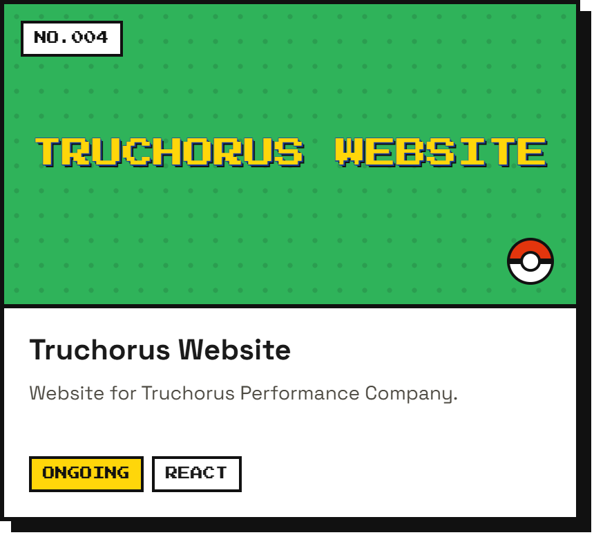</picture></a>

  <a href="https://github.com/miconakase/daily-spot-cafe"><picture><source media="(prefers-color-scheme: dark)" srcset="art/out/work-daily-spot-cafe-dark.png">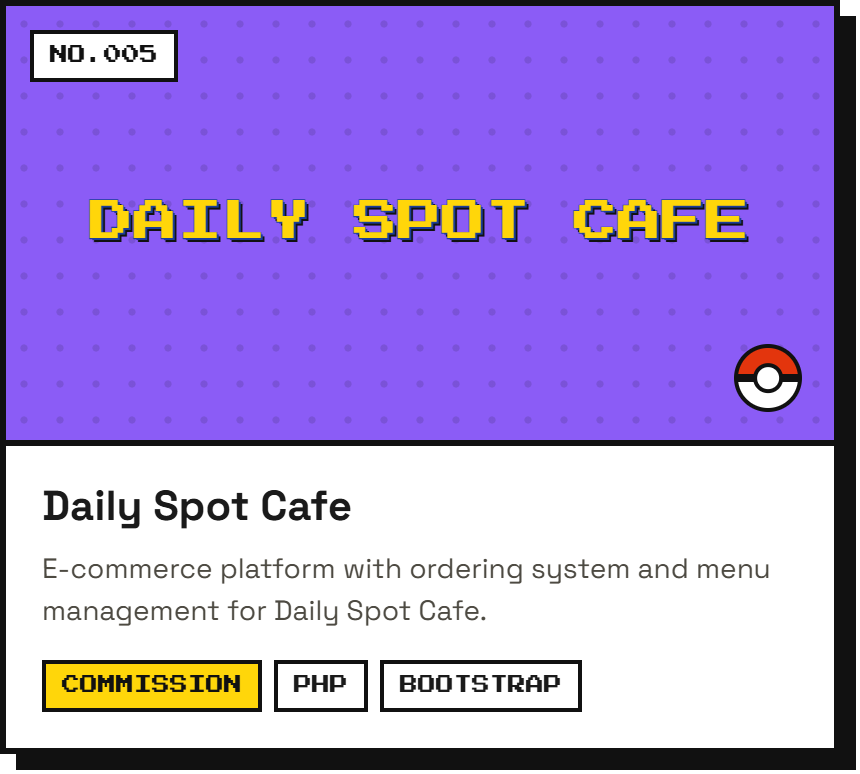</picture></a>

🧩 AI agent skills: <a href="https://github.com/miconakase/agent-skills"><b>agent-skills</b></a> — including <a href="https://github.com/miconakase/agent-skills/tree/master/tailwind-v4-grader">tailwind-v4-grader</a>, a Tailwind v4 auditor with a scored report card.

<picture><source media="(prefers-color-scheme: dark)" srcset="art/out/h-music-dark.png"></picture>

  <a href="https://www.miconakase.xyz/#works"><picture><source media="(prefers-color-scheme: dark)" srcset="art/out/track-mui-mui-dark.png">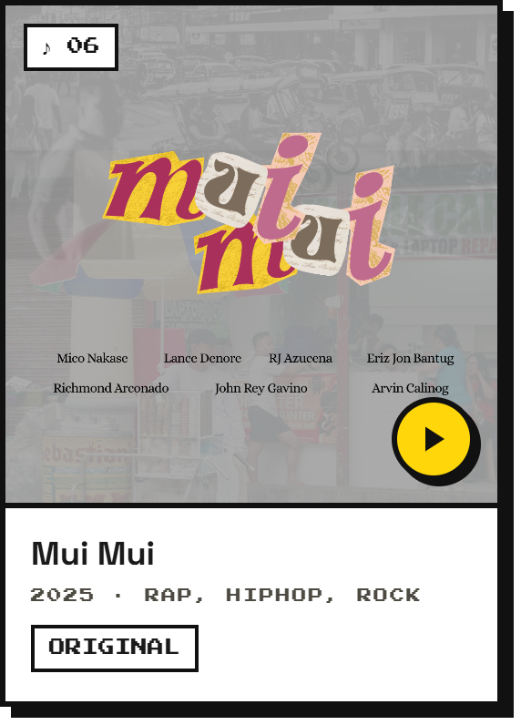</picture></a>
  <a href="https://www.miconakase.xyz/#works"><picture><source media="(prefers-color-scheme: dark)" srcset="art/out/track-ligtas-dark.png">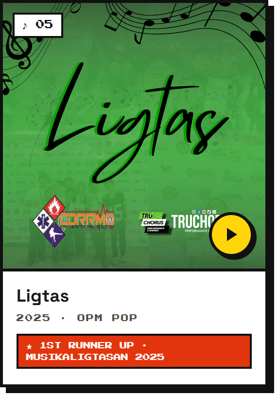</picture></a>
  <a href="https://www.miconakase.xyz/#works"><picture><source media="(prefers-color-scheme: dark)" srcset="art/out/track-mahiwagang-laguna-dark.png">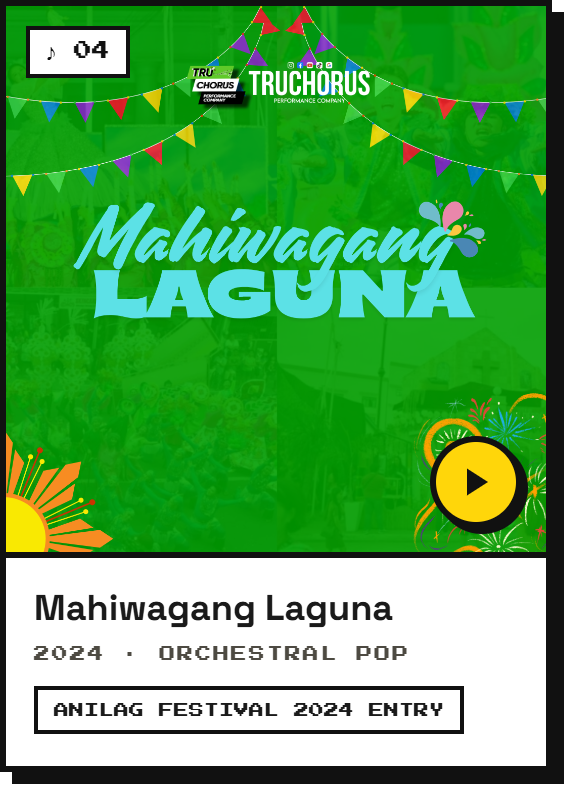</picture></a>

  <a href="https://www.miconakase.xyz/#works"><picture><source media="(prefers-color-scheme: dark)" srcset="art/out/track-samyo-ng-san-pedro-dark.png"></picture></a>
  <a href="https://www.miconakase.xyz/#works"><picture><source media="(prefers-color-scheme: dark)" srcset="art/out/track-sa-laguna-dark.png">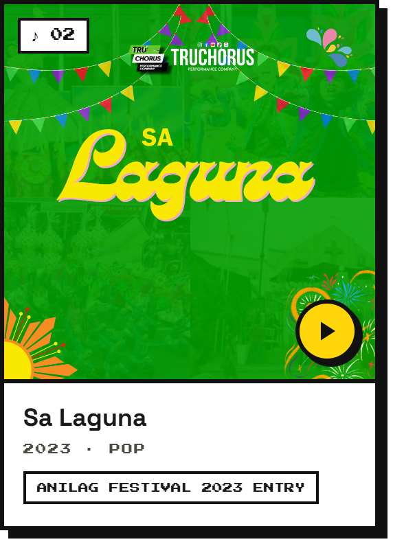</picture></a>
  <a href="https://www.miconakase.xyz/#works"><picture><source media="(prefers-color-scheme: dark)" srcset="art/out/track-ariba-bagong-san-pedro-dark.png">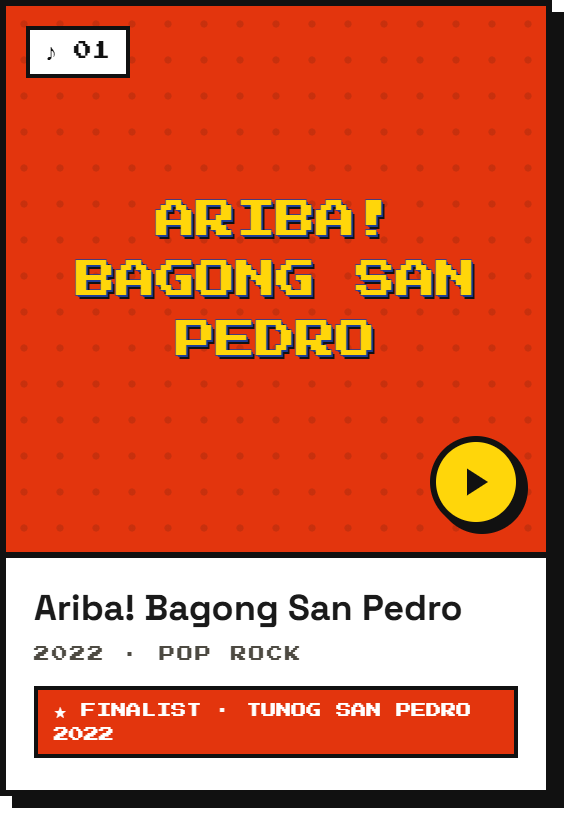</picture></a>

▶ Click a track to listen on <a href="https://www.miconakase.xyz/#works">miconakase.xyz</a>

<picture><source media="(prefers-color-scheme: dark)" srcset="art/out/h-journey-dark.png"></picture>

  <picture><source media="(prefers-color-scheme: dark)" srcset="art/out/journey-dark.png">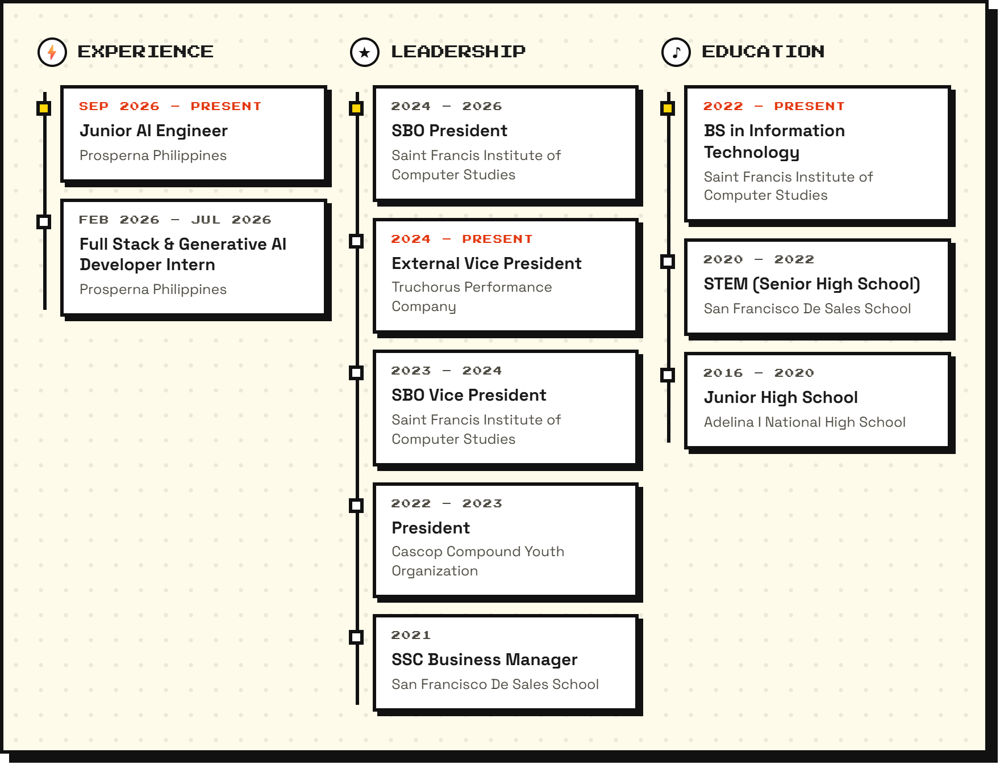</picture>

<picture><source media="(prefers-color-scheme: dark)" srcset="art/out/h-contact-dark.png"></picture>

  <a href="https://www.miconakase.xyz"><picture><source media="(prefers-color-scheme: dark)" srcset="art/out/btn-portfolio-dark.png"></picture></a>&nbsp;&nbsp;<a href="https://github.com/miconakase"><picture><source media="(prefers-color-scheme: dark)" srcset="art/out/btn-github-dark.png"></picture></a>&nbsp;&nbsp;<a href="https://www.linkedin.com/in/mico-nakase-0835b1391/"><picture><source media="(prefers-color-scheme: dark)" srcset="art/out/btn-linkedin-dark.png"></picture></a>&nbsp;&nbsp;<a href="mailto:miconakaseyt@gmail.com"><picture><source media="(prefers-color-scheme: dark)" srcset="art/out/btn-email-dark.png"></picture></a>

  <a href="https://www.tiktok.com/@micodevph"><picture><source media="(prefers-color-scheme: dark)" srcset="art/out/btn-tiktok-dark.png"></picture></a>&nbsp;&nbsp;<a href="https://www.instagram.com/itsmicssss_/"><picture><source media="(prefers-color-scheme: dark)" srcset="art/out/btn-instagram-dark.png"></picture></a>&nbsp;&nbsp;<a href="https://www.facebook.com/mics12345"><picture><source media="(prefers-color-scheme: dark)" srcset="art/out/btn-facebook-dark.png"></picture></a>

 

  <picture><source media="(prefers-color-scheme: dark)" srcset="art/out/footer-dark.png"></picture>

 

© 2026 Mico Nakase · Art generated from <a href="art/build.mjs">art/build.mjs</a>

